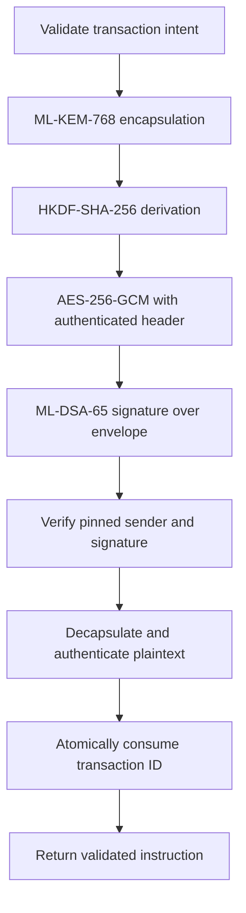

# Encrypted Transaction

**Post-quantum authenticated envelopes for bank instructions and crypto transfer intents.**

[](https://github.com/ineedfoundmyway/encrypted-transaction/actions/workflows/verify.yml)
[](https://github.com/ineedfoundmyway/encrypted-transaction/actions/workflows/pages.yml)

[Open the cryptography lab](https://ineedfoundmyway.github.io/encrypted-transaction/) · [Security model](docs/SECURITY.md) · [Protocol](docs/PROTOCOL.md) · [Sources](docs/SOURCES.md)

A dependency-free Node.js implementation with native OpenSSL primitives, strict transaction schemas, authenticated metadata and replay protection. The browser lab runs real AES-GCM encryption locally; the site also exposes execution evidence from the full Node.js PQC pipeline.

Research and study software. Deploy the static demonstration only. Do not use this unaudited protocol to process real funds or production credentials.

## Run it

Requires Node.js 24.7 or newer within the 24.x release line, with ML-KEM and ML-DSA support. No package installation is needed.

```sh
npm test
npm run demo
npm run build
npm run check
python3 -m http.server 8080 --directory docs
```

Visit `http://localhost:8080`. The build generates fresh public execution evidence without exporting private keys. Timing is a single execution measurement, not a performance benchmark. Node's KEM and SQLite APIs may emit experimental warnings.

## Security pipeline



| Component | Implementation | Boundary |
| --- | --- | --- |
| Key establishment | ML-KEM-768, FIPS 203 | Fresh encapsulation per envelope; no classical fallback |
| Sender authentication | ML-DSA-65, FIPS 204 | Public key supplied by a trusted caller, never accepted from the envelope |
| Payload encryption | AES-256-GCM | 96-bit random nonce; 128-bit tag; header authenticated as AAD |
| Key derivation | HKDF-SHA-256 | Random 256-bit salt; protocol and recipient context bound into derivation |
| Validation | Exact schemas and bounded base64url | Positive integer amounts in smallest units; no floating-point arithmetic |
| Replay control | Atomic `consume` interface | Memory store for demonstrations; SQLite store retains IDs across restarts |
| Key operations | Provider interface | Software provider included; external HSM provider requires separate integration |

## Library example

```js
import {
  generateIdentity, SoftwareKeyProvider, MemoryReplayStore, seal, open,
} from './src/index.js';

const treasury = generateIdentity('treasury');
const settlement = generateIdentity('settlement');
const envelope = await seal({
  id: 'invoice-1042',
  rail: 'bank',
  sender: 'treasury',
  recipient: 'settlement',
  asset: 'BRL',
  amount: '125050',
  network: 'bank',
  reference: 'order-1042',
}, {
  sender: new SoftwareKeyProvider(treasury),
  recipient: { name: 'settlement', encryptionKey: settlement.encryption.publicKey },
});

const instruction = await open(envelope, {
  recipient: new SoftwareKeyProvider(settlement),
  trustedSender: { name: 'treasury', signingKey: treasury.signing.publicKey },
  replayStore: new MemoryReplayStore(),
});
```

Keep the replay store alive across calls. Creating one per request defeats replay protection. For durable local acceptance records, replace it with `SQLiteReplayStore` from `src/sqlite-replay-store.js`, pointing at a protected persistent database file. It keeps accepted transaction IDs indefinitely and never evicts them automatically. Protect and back up the database and its WAL files. Multi-host services need a shared atomic store.

<details>
<summary>Bank versus crypto payloads</summary>

Bank intents use an uppercase three-letter currency, integer minor units and `network: 'bank'`. The implementation validates the shape, not a live ISO currency registry or bank account ownership.

Crypto intents use integer base units and an explicit network identifier such as `ethereum:1`. Asset symbols are illustrative; real integrations must bind the chain, contract address, decimal scale, recipient address and authorization policy. These envelopes do not sign a blockchain transaction, broadcast transfers or change blockchain consensus security.

</details>

<details>
<summary>What can I try in the visual lab?</summary>

- Encrypt a bank or crypto test instruction with a fresh browser key.
- Decrypt it and inspect the recovered fields.
- Flip one ciphertext bit and see GCM reject the message.
- Switch the full Node.js evidence between bank and crypto examples.
- Inspect accepted, replayed, modified and expired envelope results.
- Download the public envelope records and reproduce them with `npm run build`.

The browser AES lab and Node.js PQC protocol have separate, visible scopes. Build-time evidence is recorded execution, not a live browser implementation of ML-KEM or ML-DSA.

</details>

## Verification

The test suite exercises both transaction rails, every authenticated envelope field, invalid encodings, key substitution, GCM authentication failure after a valid signature, clock boundaries, concurrent replay attempts, store failure, persistent replay records and amount validation. Run `npm test` for current coverage; coverage is not a cryptographic security proof. See [the validation record](VALIDATION.md) for the local checks and publication status.

GitHub Actions runs tests, syntax checks and evidence generation before deploying `docs/` to Pages. The first Pages deployment may require a repository administrator to select **Settings → Pages → Source → GitHub Actions**. No application secrets or wallet connections are required.

## Operational limits

This is a versioned application protocol built from standard primitives, not an independently standardized or audited financial protocol. It provides neither forward secrecy after recipient key compromise nor automatic key rotation, revocation, HSM support or compliance certification. Header metadata is public. Receiver authorization, authenticated key distribution, TLS, settlement policy, durable business idempotency, audit retention and ledger atomicity remain integration responsibilities. See the [security model](docs/SECURITY.md) before extending it.

## License and credits

MIT. Created by [ineedfoundmyway](https://github.com/ineedfoundmyway) with coauthor [brunnojob](https://github.com/brunnojob). Project credits: [brunnodev.store](https://brunnodev.store).
